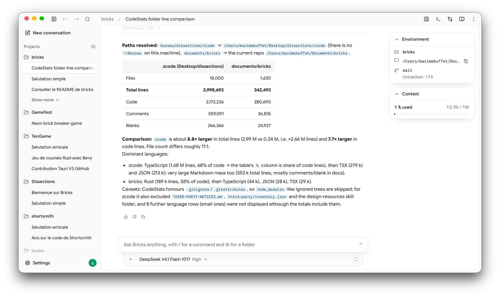
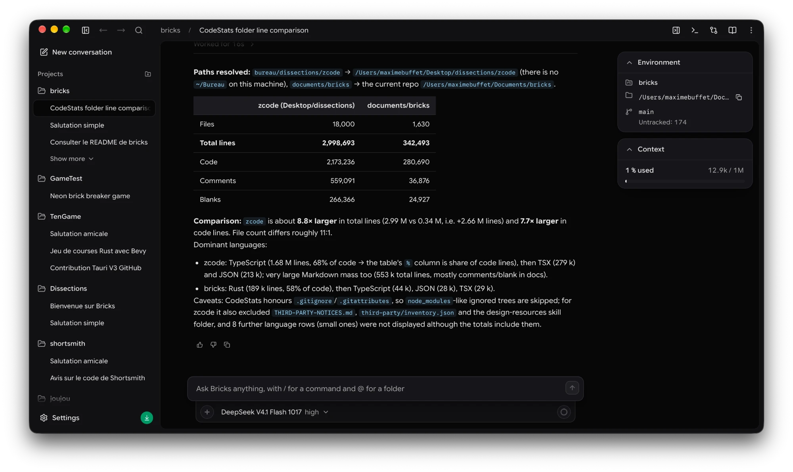
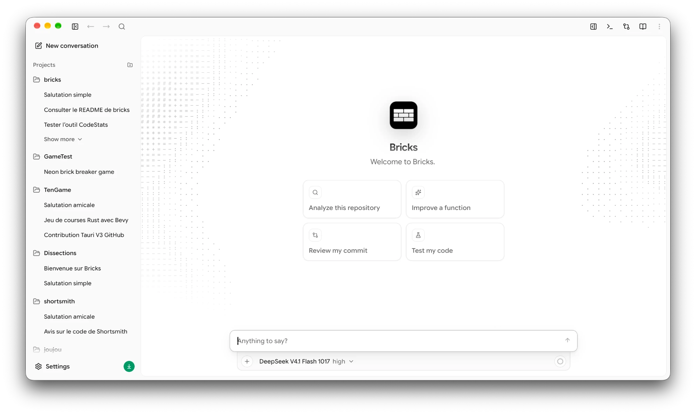
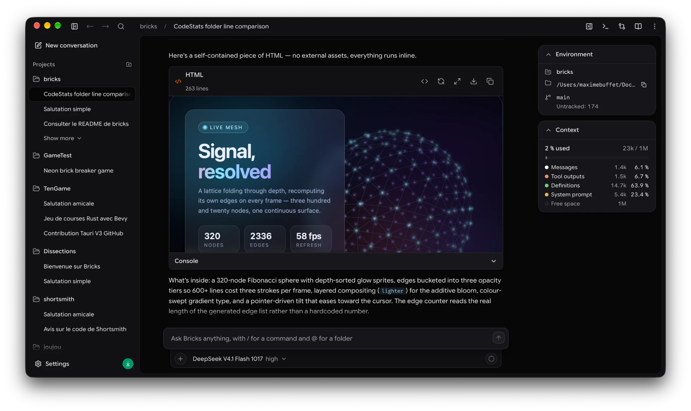
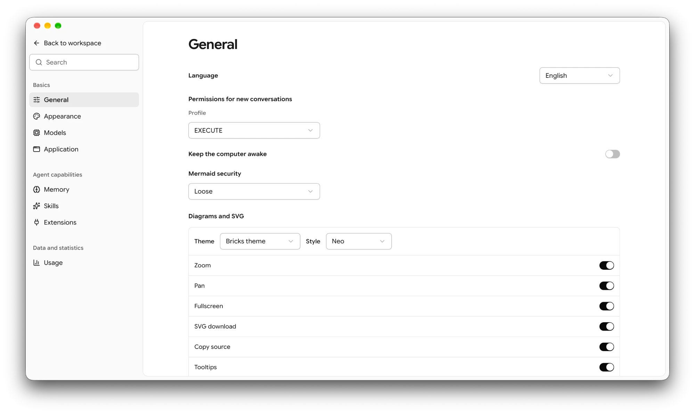
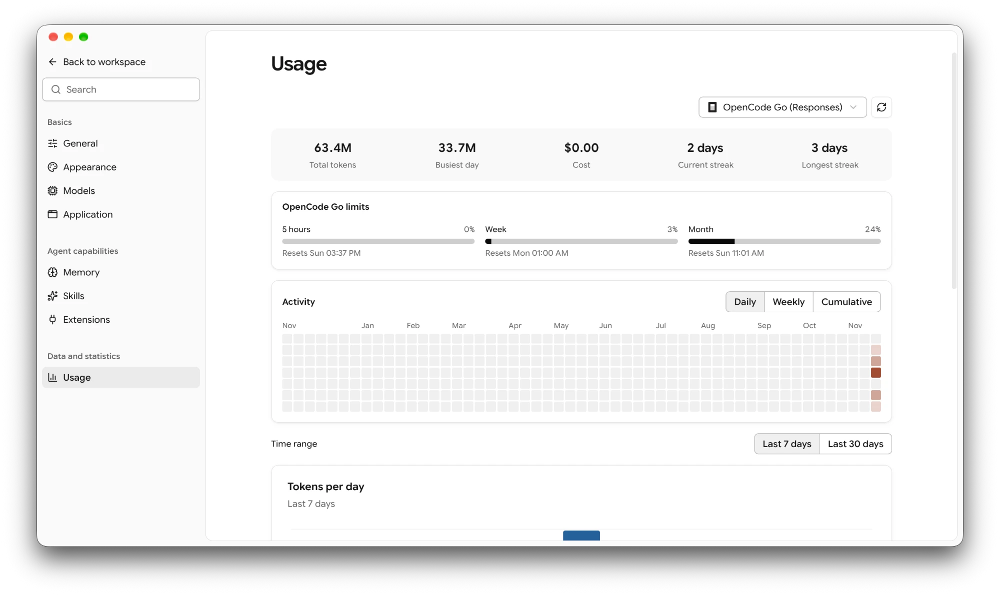

<div align="center">

# Bricks

**Your coding agent, built in Rust. Fast to open, light on your machine, yours to configure.**

[](https://github.com/AshlarAI/Bricks/releases/latest)
[](https://github.com/AshlarAI/Bricks/releases)
[](https://github.com/AshlarAI/Bricks/releases/latest)
[](https://github.com/AshlarAI/Bricks/releases/latest)
[](https://www.rust-lang.org)
[](LICENSE)

[Tour](#a-quick-tour) · [Why Bricks](#why-bricks) · [Features](#features) · [Getting started](#getting-started) · [Settings](#settings) · [CLI](#cli) · [Rust SDK](#rust-sdk) · [Development](#development) · [Documentation](#documentation) · [License](#license)


</div>

Bricks is a desktop coding agent that works inside your project folder. Ask it to explore a codebase, fix a bug, write a feature, run the tests or research a library: it reads, edits, runs commands and searches the web, and shows you every step along the way.

It runs natively, without Electron, so it opens in a blink and stays light on memory and disk. The desktop app, the command line and the Rust SDK all share one engine, so what you learn in one works the same in the others.

## A quick tour

<p align="center">
  
  
</p>
<p align="center"><sub>The same conversation in light and dark mode: a readable answer, a table, and the context panel on the right.</sub></p>

<p align="center">
  
  
</p>
<p align="center"><sub>Start from a suggestion, and watch a page the agent wrote come alive in a sandboxed preview.</sub></p>

<p align="center">
  
  
</p>
<p align="center"><sub>Everything is set from the app, and every token is counted on your machine.</sub></p>

## Why Bricks

- **Bring your own models.** Plug in any provider that speaks Chat Completions, Responses or Anthropic Messages. OpenCode Go and OpenCode Zen are built in: paste a key and you are ready.
- **You stay in control.** Every session has its own permission policy. Review diffs before a change lands, approve one call at a time, or let the agent run freely when you trust the task.
- **You see what happens.** Runs fold into a readable timeline with a live timer, changed files and the commands that ran. Nothing happens behind your back.
- **Your data stays local.** Sessions, usage records and memory notes live on your machine.
- **Checked releases.** Every official build is tested, scanned for secrets and malware, and published with SHA-256 checksums and build provenance.

## Features

### 💬 A workspace made for real projects

- **Projects and conversations.** A project is simply a folder. Search titles and messages, pin, rename, fork or delete conversations, and pick up any session later. If a project moves, Bricks asks you where it went.
- **A composer that keeps up.** Attach files, folders and images, mention files with `@`, run `/` commands, recall earlier requests, and choose the model and thinking level for each conversation.
- **Runs you can follow.** Tool activity folds under each run, with a timer while it works. The plan stays in sight, the agent can ask you questions (with an optional countdown), and you can edit a message and run it again.
- **Reader, changes and terminal.** Open project files in tabs, see what a conversation changed, browse Git status, commits and diffs, and keep several terminals open in the project folder.

### 🎨 Answers that are pleasant to read

- **Code that looks right.** Every block is highlighted by Shiki, with numbered lines, word wrap, copy and download. Long files open in their own frame, and files open whole in the reader.
- **Live HTML previews.** When the agent writes a page, it opens in a sandboxed preview with its own console, reload and full-size view. The page never reaches the app.
- **Figures, offline.** Mermaid diagrams, SVG drawings and Vega-Lite charts render locally. Zoom, pan, go full screen, view the source or export to SVG and PNG.
- **Rich Markdown.** Diffs, math, footnotes, GitHub-style alerts, link previews and clickable file paths.

### 🔌 Models and providers in one step

- **Settings › Models** lists your providers on the left and edits the selected one in place: URL, protocol, key, and each model with its context size, vision support, a test button and an on/off switch.
- **Limits that make sense.** Models imported from the catalog use their full context window as their input limit.
- **Settings › Usage** records every response locally and shows totals, cost, streaks, a year of activity, tokens per day and per model, and the OpenCode Go limits. With OpenCode, the cost shown is what the gateway actually charged.

### 🧠 An agent engine that does the heavy lifting

- **Built-in tools.** Every session starts with:

  | Area | Tools |
  |---|---|
  | Files | `Read` (text and images), `Write`, `Edit`, `ApplyPatch` |
  | Search and code | `Glob`, `Grep`, `CodeSearch`, `CodeScout`, `CodeStats` |
  | Commands | `Bash`, `PowerShell`, `Job` |
  | Web | `WebFetch`, `WebSearch` |
  | Planning and skills | `TodoWrite`, `Skill`, `Ask` (interactive sessions) |
  | Sub-agents | `Agent`, `Managent`, `Messagent` |

- **Parallel and safe.** Independent tool calls run side by side. File edits are checked again before an atomic write, and long commands continue as background jobs.
- **Sub-agents.** Hand missions to the built-in `general` and `explore` agents, or to your own profiles. Parallel writers work in isolated Git worktrees, and their changes come back for you to inspect before they are applied. On the desktop, each sub-agent opens as a read-only branch of the conversation.
- **Code understanding.** Lexical search, Tree-sitter context for Rust, TypeScript, JavaScript, Python and Go, and optional language servers.
- **Context management.** Track usage by source, compact or clear a conversation, and shrink long tool outputs while keeping the originals one click away.
- **Memory.** Optional long-term notes (280 characters each), global or per project, kept as plain Markdown files you can read, edit and delete.
- **Skills.** Install Agent Skills in Bricks' own store. Project skills run only once you trust them.
- **Web.** Search with DuckDuckGo, Brave, Tavily or Exa, with retries, caching and time and domain filters, and read pages as clean Markdown.
- **Computer Use.** Optional desktop and screen control through Cua Driver, on macOS and Windows, turned on in Settings.

### 🌗 Made to feel like home

- English or French interface, independent of the language you chat in.
- Light, dark or system theme, and a choice of light or dark app icon.
- An option to keep the computer awake during long runs.
- Built-in updates from official GitHub Releases only.

## Getting started

### Download

Grab the latest version from [GitHub Releases](https://github.com/AshlarAI/Bricks/releases):

| System | Installer | Portable |
|---|---|---|
| macOS Apple Silicon | `.dmg` | `.zip` |
| Windows x64 | `.setup.exe` | `.zip` |

The portable `.zip` needs no installation and no admin rights: unzip it, double-click, and you are running. To uninstall, delete the folder. Linux is not yet covered by release builds.

### First steps

1. Open **Settings › Models** and add a provider. For OpenCode, choose it from the list and paste your key.
2. Pick the models you want and test them with one click.
3. Open a project folder and start a conversation.

### Run from source

You need a recent stable Rust toolchain, Node.js and npm, the native build dependencies for Tauri, and a C++17 toolchain for the vector index. From the repository root:

```bash
cd apps/bricks-desktop
npm ci
npm run tauri dev
```

## Settings

Everything is set up from the app:

| Section | What you set |
|---|---|
| **General** | Interface language, permissions for new conversations, keeping the computer awake, diagrams and the question timer |
| **Appearance** | Theme and app icon |
| **Models** | Providers, keys, models, limits, reasoning profiles and tool execution |
| **Application** | Version, platform and Bricks' folders |
| **Memory** | Turn long-term memory on and manage notes, globally or per project |
| **Skills** | Import, inspect and remove skills |
| **Extensions** | Computer Use and its permissions |
| **Usage** | Tokens, cost and provider limits |

Each conversation keeps its own permission policy, and running work can be stopped from the conversation at any time.

## CLI

Prefer the terminal? Install the command-line frontend from the repository root:

```bash
cargo install --locked --path crates/bricks-cli
```

```bash
# Run one task.
bricks run "Explain the failing test in src/parser.rs"

# Stream JSONL events for scripts and CI.
bricks run --json --non-interactive "Analyse the build errors"

# List and continue stored sessions.
bricks sessions
bricks run --session <id> "Continue where we stopped"
```

Use `--permissions ask` or `--permissions execute` to choose a profile, `--file` and `--image` to attach content, and `--skill` to activate a skill. The [CLI reference](docs/cli.md) covers configuration, events and exit codes.

## Rust SDK

Want to build your own agent? The engine behind Bricks is available through the `bricks` facade and the `bricks-*` crates: the same model connections, tools, context management, sessions and permission engine as the desktop app. Add tools with the `Tool` trait and its derive macro, connect MCP servers over stdio or Streamable HTTP, and hook into the agent lifecycle.

Further crates cover workflows (`bricks-workflows`), sandboxes (`bricks-vms`), embeddings (`bricks-embeddings`), an agent template language (`bricks-agentlang`) and self-evolving orchestration (`bricks-agentrl`).

Start with the [agent API](docs/content/docs/api-agent.mdx), the [architecture](docs/content/docs/architecture.mdx) and the [crate map](docs/content/docs/crate-map.mdx).

## Development

Rust tests use [Nextest](https://nexte.st/):

```bash
cargo nextest run --workspace --locked
```

For the full workspace validation, including every target:

```bash
./scripts/run_tests.sh
```

Desktop checks, from `apps/bricks-desktop`:

```bash
npm run check
npm run test:types
npm run test:unit
```

Model-facing tests use scripted providers and local servers, and live API tests are opt-in. Builds and test runs fill `target`, so keep an eye on its size.

## Documentation

| Guide | Contents |
|---|---|
| [CLI and desktop](docs/cli.md) | Sessions, permissions, commands and events |
| [Providers](docs/providers.md) | Models, protocols, limits and reasoning profiles |
| [Context](docs/context.md) | Usage accounting and compaction |
| [Compression](docs/compression.md) | Tool-output reduction and originals |
| [Built-in tools](docs/content/docs/built-in-tools.mdx) | Every tool of the SDK |
| [Shell and files](docs/shell.md) | Commands, edits and background jobs |
| [Sub-agents](docs/agents.md) | Profiles, delegation and worktrees |
| [Code understanding](docs/semantic.md) | CodeScout, syntax and optional LSP |
| [Memory](docs/memory.md) | Markdown notes, scopes and tools |
| [Skills](docs/skills.md) | Skill installation and activation |
| [MCP](docs/mcp.md) | The SDK's MCP client |
| [Web](docs/web.md) | Search and page reading |
| [Maintenance](docs/maintenance.md) | Builds, publishing and dependencies |
| [Migration](docs/content/docs/migration.mdx) | Removed APIs and configuration changes |
| [Changelog](CHANGELOG.md) | Every change, commit by commit |

The documentation website lives in [docs/](docs/README.md).

## License

New contributions to Bricks are licensed under the [Mozilla Public License 2.0](LICENSE), file by file. Copyright © 2026 AinsiParlaitZarathoustra.

Code inherited from Cersei, up to commit [`fa7af2b8`](https://github.com/AinsiParlaitZarathoustra/Bricks/commit/fa7af2b8e7d6d6fb89f25dab2f6f4a1d0cf2885e), stays under the MIT license: Copyright (c) 2025 Adib Mohsin and contributors. Its notices must be kept when that code is reused or modified.
